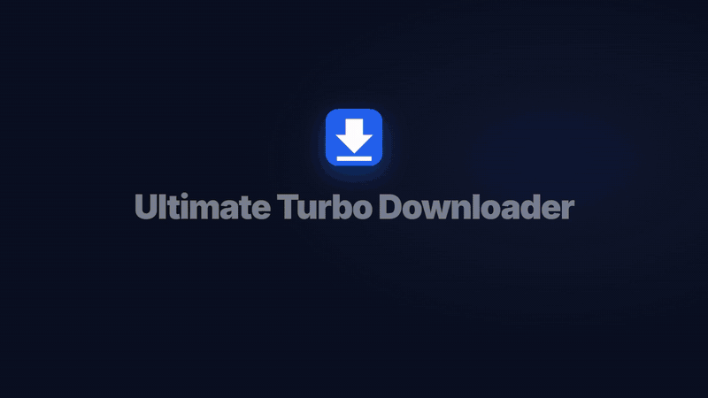
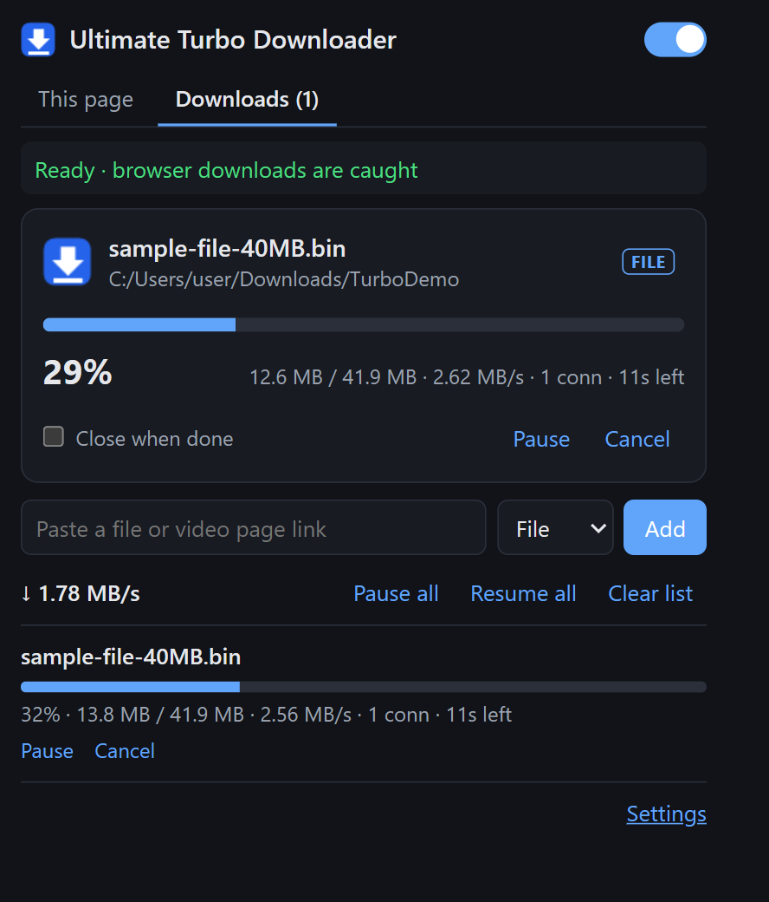
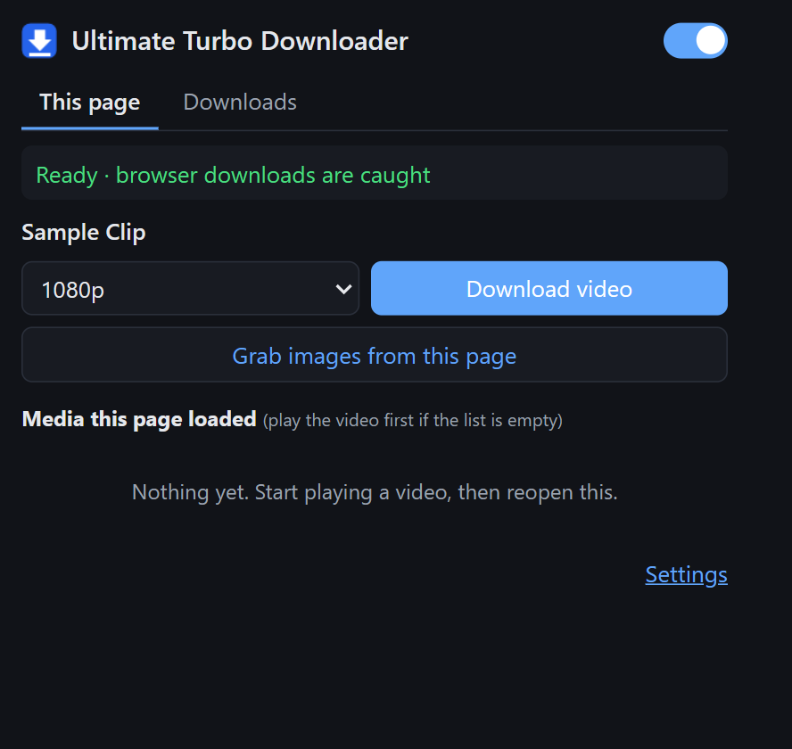
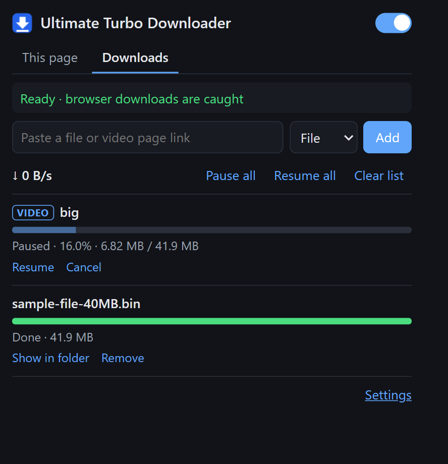
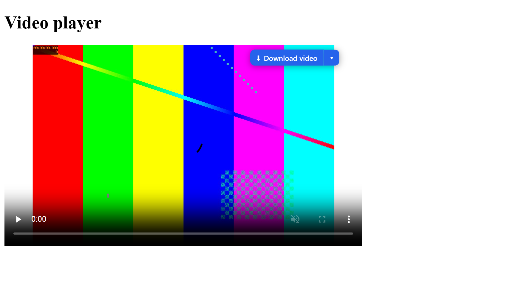
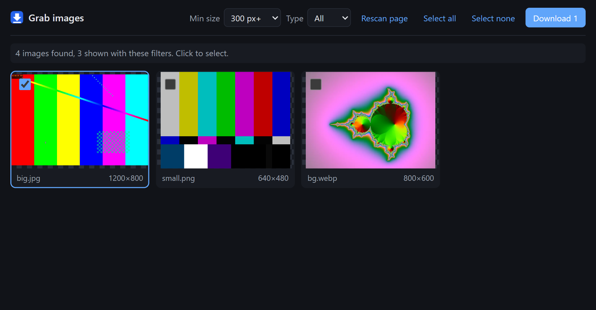
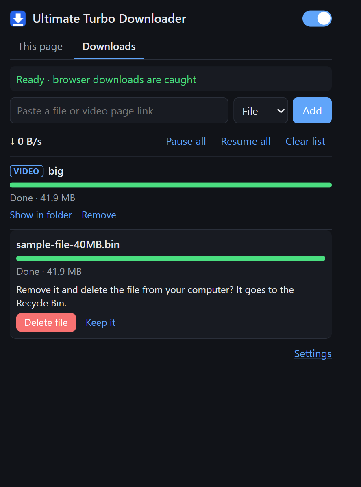
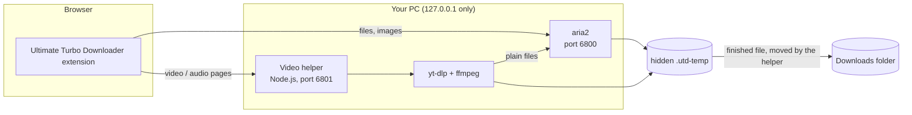
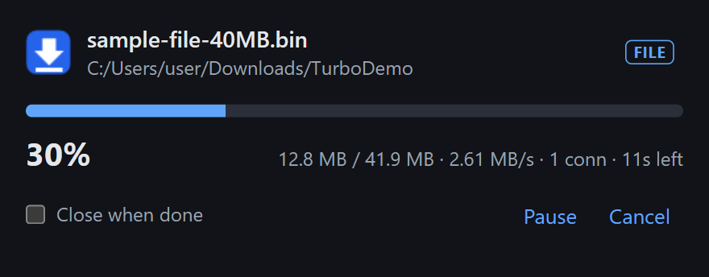

<p align="center">
  
</p>

<h1 align="center">Ultimate Turbo Downloader</h1>

<p align="center">
  An open-source, IDM-style download manager for Chrome, Edge, Brave and other Chromium browsers.<br>
  Multi-connection file downloads · videos from 1,800+ sites · image grabber · live progress under the toolbar icon.
</p>

<p align="center">
  <a href="LICENSE"></a>
  
  
  
</p>

## Video guide

<p align="center">
  <a href="docs/setup-guide.mp4"></a>
</p>

Above: highlights. The full 90-second, step-by-step walkthrough covers getting the code,
running setup, loading the extension and pasting the secret, then catching downloads, grabbing
videos, pausing and resuming, and grabbing images.
**[▶ Watch the full setup guide (MP4, 5 MB)](docs/setup-guide.mp4)**

<p align="center">
  
  
  
</p>

## Features

- **Faster file downloads.** Every download you start in the browser is handed to
  [aria2](https://aria2.github.io/), which splits the file and downloads up to 16 parts at once.
  Your cookies, referrer and user agent go with it, so downloads that need a login still work.
- **Adapts to the server.** If a server refuses many connections (HTTP 429 and similar), the
  download is re-added with half as many (16 → 8 → 4 → 2 → 1), keeping what's already downloaded.
- **Videos and audio from 1,800+ sites** through [yt-dlp](https://github.com/yt-dlp/yt-dlp):
  YouTube, Facebook, Instagram (reels, posts, stories), TikTok, X/Twitter, Vimeo, Reddit, Twitch,
  Dailymotion and many more. Choose Best, 4K, 1080p, 720p, 480p or MP3.
- **A "⬇ Download video" button over any video** on a page, plus a quality menu.
- **A media sniffer** that lists the video and stream files a page loaded (MP4, WebM, HLS, DASH),
  for sites yt-dlp doesn't know.
- **An image grabber** that collects every image on a page (full-size `srcset` versions, CSS
  backgrounds, `og:image`, links to image files) with size and type filters.
- **Live progress under the toolbar icon**, with Pause / Resume / Cancel, then Open / Show in folder.
- **Pause and resume anything**, files and videos alike, even after a restart.
- **No half-finished files in your folder.** Downloads build up in a hidden `.utd-temp` folder,
  and only the finished file is moved into your Downloads folder (renamed `name (1).ext` if the
  name is taken).
- **Remove asks first.** Removing a finished download deletes its file too, after you confirm,
  and the file goes to the **Recycle Bin**, so a slip can be undone. Cancelling cleans up the
  unfinished pieces. **Clear list** only tidies the list and never touches your files.
- **Keeps going without the browser.** Downloads continue after you close it, and unfinished
  ones resume after a restart.
- **Private by design.** Everything runs on your own PC, with no servers, accounts, analytics or tracking.

<p align="center">
  
  
</p>
<p align="center">
  
</p>

## How it works



A browser extension can't open dozens of connections or run programs itself, so the extension
hands the work to two small helpers that run in the background on your PC. Both only accept
requests from this computer, and only with a secret that setup creates.

## Requirements

- Windows 10 or 11. The extension works in any Chromium browser, but the helper scripts are
  Windows-only for now.
- [Node.js](https://nodejs.org/) 18 or newer (runs the video helper)
- [aria2](https://aria2.github.io/) and [yt-dlp](https://github.com/yt-dlp/yt-dlp). Setup can
  install both with `winget`.
- [ffmpeg](https://ffmpeg.org/), recommended: needed for best-quality YouTube (separate video and audio
  streams) and MP3. Install it with `winget install Gyan.FFmpeg`.

## Install

1. **Get the code.** Click **Code → Download ZIP** and unzip it, or `git clone` this repository.
2. **Set up the helpers.** In the project folder, run:
   ```powershell
   powershell -ExecutionPolicy Bypass -File helper\setup.ps1 -InstallAria2 -InstallYtDlp -Autostart
   ```
   - It installs aria2 and yt-dlp if they're missing, creates a random secret (copied to your
     clipboard), and starts both helpers.
   - `-Autostart` starts them at every login. Leave it out to start them yourself with
     `helper\start-helpers.vbs`.
   - `-Dir D:\Downloads` saves files somewhere other than your Downloads folder.
3. **Load the extension.** Open `chrome://extensions` (or `edge://extensions`), turn on
   **Developer mode**, click **Load unpacked**, and select the `extension` folder.
4. **Connect it.** Right-click the Ultimate Turbo Downloader icon → **Options**, paste the secret
   (it's also in `helper\secret.txt`), and click **Save**. **Test connection** should report that both
   aria2 and yt-dlp are connected.

> **Updating:** after pulling a new version, click **Reload** on the extension in
> `chrome://extensions`, and run `setup.ps1` again if anything in `helper/` changed.

## Using it

| To… | Do this |
|---|---|
| Download a file faster | Just download it as usual. Ultimate Turbo Downloader takes it over. |
| Download a video | Hover over it and click **⬇ Download video** (▾ for quality or MP3), or open the popup → **This page** → **Download video** |
| Download from a site yt-dlp doesn't know | Play the video, then popup → **This page** → **Media this page loaded** → **Download** |
| Download images | Popup → **This page** → **Grab images from this page** (or right-click the page) |
| Download a link directly | Paste it in the popup's **Downloads** tab and choose **File** or **Video** |
| Pause or resume a download | **Pause** / **Resume** on its row or its progress card (**Pause all** / **Resume all** for everything) |
| Delete a finished download | **Remove** on its row, then **Delete file**. It goes to the Recycle Bin. |
| Tidy the list but keep the files | **Clear list** |
| Pause catching browser downloads | Use the switch at the top of the popup |

### Progress display

When a download starts, its progress opens **in the extension popup, right under the toolbar
icon**. You can change that in Options:

- **In the extension popup** (default). If the browser can't open the popup by itself (for
  example, no browser window is focused), a small window is used instead.
- **In a small separate window** at the top right of the browser, IDM-style.
- **Don't show it.** The badge on the icon still shows how many downloads are active.

<p align="center"></p>

## Speed

Ultimate Turbo Downloader only gets faster when the **server** (or the distance to it) limits each
connection. If your internet line is already full, nothing can make it faster, IDM included. The defaults were tuned
on a real home connection of about 300 Mbps:

| Test | Result |
|---|---|
| Distant server allowing 2 connections, default TCP buffers | 9.8–18.5 MB/s |
| Same server, **16 MB TCP receive buffers** (now the default) | **26.6–36.0 MB/s** (2–3× faster) |
| UK server allowing 16 connections | 24.6–33.6 MB/s (230–270 Mbps, close to the line's limit) |
| YouTube video (yt-dlp) | about 40 MB/s |

The defaults are 16 connections per file (stepping down automatically when refused), 16 MB
socket buffers, 1 MB segments, a 64 MB disk cache, no pre-allocation, adaptive mirror
selection, 16 parallel fragments for HLS/DASH video, and up to 5 downloads at once (aria2 adjusts
this to your bandwidth). Your Windows network settings are never changed.

All sizes and speeds are shown in **MB** and **MB/s** (1 MB = 1,000,000 bytes). Internet plans
are sold in megabits: **MB/s × 8 ≈ Mbps**.

## Limits

- **DRM-protected streams can't be downloaded**: Netflix, Disney+, Prime Video, Spotify, and most paid TV.
  This project does not and will not break DRM.
- **Sites change and break downloaders.** When a site stops working, click **Options → Update yt-dlp**.
- **Facebook stories** have no yt-dlp support. They work through "Media this page loaded",
  but some keep audio and video in separate files.
- **Not caught by design:** `blob:` / `data:` downloads made by page scripts, and downloads that need a form POST.
  These stay with the browser. So does everything while the helpers aren't running (the icon
  shows a red `!`), so nothing is lost.

## FAQ

**Why aren't downloads listed in the browser's own Downloads page?**
Chrome and Edge only list downloads the browser itself performs, and extensions can't add to
that list. Ultimate Turbo Downloader's downloads happen outside the browser (that's what makes them fast
and lets them continue after the browser closes), so they get their own progress display, just as
IDM's do.

**Where are unfinished downloads?**
In a hidden `.utd-temp` folder inside your download folder. Each file is moved out when it's
complete, so your folder never shows half-finished pieces. To see the temp folder, turn on
**View → Show → Hidden items** in File Explorer.

**I removed a download by mistake.**
Its file is in the Recycle Bin. Right-click it there and choose **Restore**.

**Does it collect any data?**
No. There are no servers, accounts, analytics or tracking. Everything stays on your PC.

**Is it legal?**
The tool is legal. What you download with it is up to you. Respect copyright and each site's
terms, and download only what you have the right to.

**macOS / Linux?**
The extension and video helper are cross-platform JavaScript. Only `setup.ps1` and the `.vbs`
launcher are Windows-specific. Contributions for other platforms are welcome.

## Project structure

```
extension/                 Chromium extension (Manifest V3, plain JS, no build step)
  background.js            catching downloads, retries, video sniffer, menus, notifications
  popup.*                  toolbar popup (This page / Downloads / live progress card)
  progresscard.js          live progress card (used by the popup and the progress window)
  progress.*               separate progress window
  overlay.js               "Download video" button over videos
  images.*                 image grabber
  options.*                settings
  rpc.js, media.js         clients for aria2 and the video helper
helper/
  media-server.mjs         video helper: runs yt-dlp jobs (Node.js, no npm dependencies)
  setup.ps1                installs and configures everything, autostart
  start-helpers.vbs        (generated) starts both helpers hidden
  stop-helpers.ps1         stops both (unfinished downloads are saved)
  remove-autostart.ps1     turns off start-at-login
docs/                      screenshots
```

## Contributing

Issues and pull requests are welcome. See [CONTRIBUTING.md](CONTRIBUTING.md). For security
reports, see [SECURITY.md](SECURITY.md).

## Credits

Ultimate Turbo Downloader stands on these projects, which it runs as separate programs. They aren't
bundled, and each keeps its own license:
[aria2](https://github.com/aria2/aria2) (GPL-2.0),
[yt-dlp](https://github.com/yt-dlp/yt-dlp) (Unlicense),
[FFmpeg](https://ffmpeg.org/) (LGPL/GPL) and
[Node.js](https://nodejs.org/) (MIT).

Ultimate Turbo Downloader is an independent project and is not affiliated with Internet Download Manager
(IDM) or Tonec Inc.

## Author

**Nawod Madhuwantha** · [www.nawodmadhuwantha.com](https://www.nawodmadhuwantha.com)

## License

[MIT](LICENSE) © 2026 Nawod Madhuwantha
